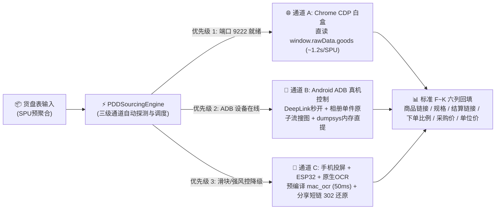

# 拼多多采购寻源与安卓真机/CDP自动化引擎 (pddauto)

[](VERSION)
[](#一三级极速通道架构)

本仓库是从多平台商品运营体系中独立拆出的**拼多多采购寻源、安卓真机控制找链接、同 SPU 多规格聚合比价与标准六列（`F~K` 列）结算链接回填 Skill**。

---

## 一、 三级极速通道架构



| 对比维度 | 通道 A：Chrome CDP 白盒直提 (`cdp_whitebox`) | 通道 B：Android ADB 真机控制 (`usb_debug`) | 通道 C：ESP32 物理拟真 + 原生 OCR (`esp32_physical`) |
| :--- | :--- | :--- | :--- |
| **底层通道** | WebSocket 直连本机已登录常规 Chrome（端口 `9222`） | Android ADB 调试协议 + Intent DeepLink + Activity 内存转储 | 手机投屏窗口控制 + ESP32 BLE HID + 预编译 `mac_ocr` |
| **核心优势** | 无需操作手机屏幕；直接读取 `window.rawData`，一次性拿出全部子规格 | 支持调用拼多多 App 原生**相册以图搜图**（`search_image_capture.html`），同款视觉识别极准 | 零系统调试特征，可穿透高对抗人机滑块与设备指纹风控 |
| **单 SPU 耗时** | **~1.2 ~ 1.5 秒/SPU** | **关键词 0.1s 秒开 + 105ms 内存提取**；以图搜图约 **2.0s/SPU** | **2.5 ~ 3.5 秒/SPU**（配合预编译 `mac_ocr` 50ms 视觉识别） |
| **规格与价格获取** | 直读 `window.rawData.store.initDataObj.goods.skus` | `adb shell "dumpsys activity com.xunmeng.pinduoduo"` | 点击分享复制短链 ➔ 302 还原 `goods_id` |

---

## 二、 核心能力与目录结构

```text
pddauto/
├── SKILL.md                                           # 🧭 Skill 顶层入口与核心铁律
├── README.md                                          # 📖 仓库导览与架构说明
├── VERSION                                            # 版本号 (1.0.0)
├── quick_validate.py                                  # 语法与单元测试一键自检脚本
├── agents/
│   └── openai.yaml                                    # Agent 界面展示与默认提示词配置
├── references/
│   ├── platforms/
│   │   ├── pdd.md                                     # 第 1 层：拼多多采购端总入口
│   │   └── pdd-sourcing-playbook.md                   # 第 3 层：CDP / ADB / ESP32 实战规程与代码配方
│   └── tasks/
│       └── sourcing-and-similar-product-matching.md   # 第 2 层：寻源 SOP、相似品四级打分与 F~K 六列合同
└── scripts/
    ├── pdd_sourcing_engine.py                         # 🛠️ 拼多多三级极速寻源与结算链接合成引擎
    ├── test_pdd_sourcing_engine.py                    # ✅ 引擎确定性单元测试
    └── vision_ocr.swift                               # 🔍 macOS Apple Vision 原生极速 OCR 源码
```

---

## 三、 标准六列交付 Schema（`F~K` 列）

| 列序号 | 列名 | 填充规范与公式 | 示例数据 |
| :---: | :--- | :--- | :--- |
| **F 列** | **拼多多商品链接** | `https://mobile.yangkeduo.com/goods.html?goods_id={goods_id}` | `https://mobile.yangkeduo.com/goods.html?goods_id=940322316708` |
| **G 列** | **拼多多规格** | 真实子规格文本；**多级规格严格以中文分号 `；` 间隔** | `480ML*9瓶【囤货】；混合口味 【新老包装随机】` |
| **H 列** | **结算链接** | `https://mobile.yangkeduo.com/order_checkout.html?goods_id={goods_id}&sku_id={sku_id}&goods_number=1` | `https://mobile.yangkeduo.com/order_checkout.html?goods_id=940322316708&sku_id=1892532124926&goods_number=1` |
| **I 列** | **下单比例** | $\max(1, \text{round}(\text{PDD规格内含件数} \div \text{门店SKU件数}))$ | `9` |
| **J 列** | **采购价** | `parseFloat(sku.group_price)`（单位：**元**，保留 2 位小数，严禁除以 100） | `44.00` |
| **K 列** | **单位采购价** | 动态公式 `=ROUND(J{row}/I{row}, 2)` | `=ROUND(J2/I2, 2)` |

---

## 四、 本地自检与测试

```bash
python3 quick_validate.py
```
