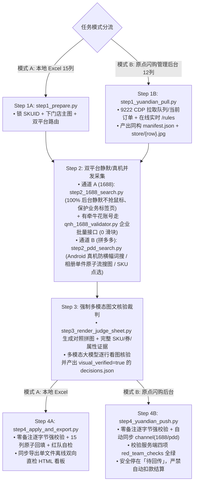

# 1688 & 拼多多多模态采购寻源与双模式交付引擎 (pddauto)

[](VERSION)
[](#一双模式全流程闭环架构)
[](#一双模式全流程闭环架构)

本仓库专用于即时零售闪电仓与多渠道货盘的 **1688 源头工厂 + 拼多多真机原生 App 高标准自动化采购寻源、食品/快消品第一轮拼多多物理硬锁、多模态视觉拼图裁判、零人工备注逐字节规格强校验与双模式安全回填 Skill (`pddauto v3.4.0`)**。

---

## 一、双模式全流程闭环架构

**核心设计**：一套高标准寻源核价内核（Step 2 & Step 3） + 两个可插拔任务适配器（Step 1 & Step 4）。



---

## 二、八大核心强制闸门

1. **严禁盲填，必过视觉拼图裁判**：所有命中项必须经 `step3_render_judge_sheet.py` 拼图 + 多模态强模型审图并标 `"visual_verified": true`。
2. **100% 后台静默，绝不抢鼠标与业务标签页**：`cdp_1688.py` 仅使用静默 DOM / `Page.navigate` / `Target.createTarget(..., background=True)`，仅复用空白页或已打开的 1688 标签页，绝不劫持任何现有业务或用户标签页。
3. **严禁绕过任何验证码/滑块/风控**：遇拦截立即退出码 `9` 停止并回报人工。
4. **严格核价口径**：拼多多计入常规店铺券/平台券/百亿补贴/大促直降（不计个人新客/赔付红包），排除临期与售罄；1688 核对阶梯价、起订量、分摊运费及商品属性。
5. **供货规格零人工备注、逐字符原样匹配**：严禁添加 `(包邮)`、`起批`、`券后` 等人工备注，双层规格严格用英文分号加空格 `; ` 连接；代码层内置 `validate_verbatim_spec` 硬拦截。
6. **双模式原子回填 + 红队自检 + 结算安全锁**：
   - Excel 模式：校验 `SKUID` 锁行、`=ROUND(L{r}/K{r},2)` 公式、ZIP 完整性与红队自检；
   - 原点闪购模式：校验 `SKUID` 锁行、自动同步 `channel`（`1688`/`pdd`）、核验服务端四项 `red_team_checks` 全绿，且**物理不实现 `/deliver` 与 `/cancel`**，确保绝不误触发扣款结算。
7. **交付物完整同步**：Excel 模式必同时交付 `.xlsx` 与离线直检 HTML 看板；原点闪购模式必落盘 `yuandian_push_report.json` 并静默刷新后台页供人工点击结算。
8. **食品与快消品「第一轮锁死拼多多」物理硬锁（v3.4 新增）**：所有食品吃喝与快消日化商品在 Step 1 自动标记 `platform_policy = "pdd_first_lock"`，**第一轮必须先完成拼多多真机实搜**；`step2_1688_search.py`、`step4_apply_and_export.py`、`step4_yuandian_push.py` 均内置物理阻断（无 CLI 绕过开关），仅当磁盘存在非阻断拼多多实搜铁证（`pdd_*/R{row}.json`）且显式声明 `pdd_fallback_reason` 为 `"pdd_no_match"` 或 `"pdd_low_margin"`（附带 `pdd_best_unit_price` 时强制反验毛利 `< 50%`）时，才允许二轮转 1688 补找与入表。

---

## 三、目录结构

```text
pddauto/
├── SKILL.md                                  # 主执行规程与八大强制闸门 (v3.4.0)
├── README.md                                 # 仓库导览与双模式快速上手
├── VERSION                                   # 版本号 (3.4.0)
├── quick_validate.py                         # 全量 Python/Node 语法与单元测试一键自检
├── agents/
│   └── openai.yaml                           # Agent 界面展示与默认提示词
├── references/
│   ├── pricing-and-matching-contract.md      # 15 列架构、核价口径、匹配容差与状态枚举
│   ├── yuandian-saas-adapter.md              # 原点闪购管理后台 12 列适配、动态规则与结算安全锁
│   ├── anti-risk-and-device-sop.md           # 1688 静默防抢鼠标、防滑块节奏与真机 ADB 规范
│   └── tool-io-schemas.md                    # 全部脚本 CLI 参数与 JSON 输入输出契约
└── scripts/
    ├── lib/
    │   ├── cdp_1688.py                       # 1688 静默后台 Chrome CDP 引擎（含业务标签页保护）
    │   ├── cdp_yuandian.py                   # 原点闪购管理后台静默 CDP API 客户端（禁调用结算/取消）
    │   └── adb_pdd.py                        # 拼多多真机原生 App ADB + Vision OCR 原子流引擎
    ├── tools/
    │   └── mac_ocr.swift                     # macOS Vision OCR Swift 源码（缺失时自动编译）
    ├── step1_prepare.py                      # Step 1A (Excel): 读表锁 SKUID、下门店图、路由分类
    ├── step1_yuandian_pull.py                # Step 1B (原点后台): 拉队列/当前订单/在线规则 -> manifest.json
    ├── step2_1688_search.py                  # Step 2A: 1688 静默图搜/词搜/详情与二级 SKU 点击
    ├── step2_pdd_search.py                   # Step 2B: 拼多多防横幅词搜/相册原子搜图/SKU 点选
    ├── step3_render_judge_sheet.py           # Step 3: 强制多模态审图拼图与证据文本生成
    ├── step4_apply_and_export.py             # Step 4A (Excel): 原子写回 + 红队自检 + 同步出 HTML
    ├── step4_yuandian_push.py                # Step 4B (原点后台): 零备注强校验回填 + 渠道同步 + 红队验证
    ├── qnh_1688_validator.py                 # 牵牛花企业 1688 批量取真规格/价/库存与导入前预校验
    ├── qnh_spu_extractor.mjs                 # 牵牛花后台 SPU 主图与指导价高速抓取器
    ├── export_visual_audit_html.py           # 单文件离线双向直检 HTML 看板导出器
    ├── audit_server.mjs                      # 可选本机 8899 看板直连写盘服务
    ├── capability_registry.json              # Skill 渐进式能力注册表 (v3)
    ├── route_skill.py                        # 任务/平台渐进式路由器
    ├── unit_alignment.mjs                    # 包装语义解析与单位对齐核心算法
    ├── test_yuandian_adapter.py              # 原点闪购双模式适配与安全闸门单元测试
    ├── test_progressive_router.py            # 路由器单元测试
    └── test_ratio.mjs                        # 包装换算比率回归测试集
```

---

## 四、快速上手

### 模式 A：本地 15 列 Excel 寻源与直检看板
```bash
python3 scripts/step1_prepare.py --excel /abs/path/to/target.xlsx --workdir /abs/path/to/work --only-unmatched
# 运行 step2_1688_search.py / step2_pdd_search.py / qnh_1688_validator.py 采集候选
# 运行 step3_render_judge_sheet.py 生成拼图 -> 多模态模型输出 decisions.json
python3 scripts/step4_apply_and_export.py --excel /abs/path/to/target.xlsx --decisions /abs/path/to/work/decisions.json
```

### 模式 B：原点闪购管理后台 (`saas.fuliops.cn/procurement-sourcing`) 实时订单寻源
```bash
# 1. 查看 9222 浏览器中原点后台待处理订单队列
python3 scripts/step1_yuandian_pull.py --list-tasks --port 9222

# 2. 拉取当前页面打开的订单与在线实时规则，产出同构 manifest.json
python3 scripts/step1_yuandian_pull.py --workdir /abs/path/to/work --only-pending --port 9222

# 3. 复用 Step 2 (1688 + 拼多多真机 App) & Step 3 (视觉拼图裁判) 产出 decisions.json

# 4. 预演校验 & 正式回填（同步 channel + 红队四项自检 + 安全停在「待回传」）
python3 scripts/step4_yuandian_push.py --workdir /abs/path/to/work --decisions /abs/path/to/work/decisions.json --port 9222 --dry-run
python3 scripts/step4_yuandian_push.py --workdir /abs/path/to/work --decisions /abs/path/to/work/decisions.json --port 9222
```

### 运行全量语法与单元测试自检
```bash
python3 quick_validate.py
```
