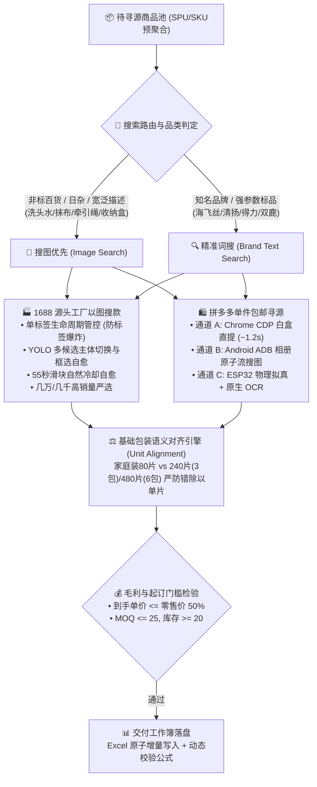

# 拼多多与 1688 采购寻源与自动化比价引擎 (pddauto)

[](VERSION)
[](#一多平台极速通道架构)

本仓库专用于即时零售闪电仓与多渠道货盘的**跨平台（1688 源头工厂 + 拼多多单件包邮）采购寻源、同 SPU 多规格聚合比价、相似品多模态核验及标准结算链接回填 Skill**。

---

## 一、 多平台极速通道架构



---

## 二、 核心目录结构

```text
pddauto/
├── SKILL.md                                           # 🧭 Skill 顶层入口与八大核心红线
├── README.md                                          # 📖 仓库导览与架构说明
├── VERSION                                            # 版本号 (2.0.0)
├── quick_validate.py                                  # 语法与单元测试一键自检脚本
├── agents/
│   └── openai.yaml                                    # Agent 界面展示与默认提示词配置
├── references/
│   ├── platforms/
│   │   ├── pdd.md                                     # 拼多多采购端平台入口
│   │   ├── pdd-sourcing-playbook.md                   # 拼多多 CDP / ADB / ESP32 实战规程与代码配方
│   │   └── ali1688-sourcing-playbook.md               # 1688 单标签防风控与 55s 滑块自愈手册
│   └── tasks/
│       ├── sourcing-and-similar-product-matching.md   # 寻源 SOP、相似品四级打分与六列合同
│       ├── unit-alignment-spec.md                     # 基础销售单位与多层级包装语义对齐规范
│       └── visual-bounding-box-sop.md                 # 以图搜款多主体修正与 YOLO 框选 SOP
└── scripts/
    ├── unit_alignment.mjs                             # ⚖️ 包装语义解析与单位对齐核心算法
    ├── test_ratio.mjs                                 # ✅ 13 大典型实战用例自动化回归测试集
    ├── ali1688_sourcing_worker.mjs                    # 🏭 1688 高销以图搜款与单标签常驻检索主引擎
    ├── pdd_phone_worker_v3.mjs                        # 📱 拼多多移动端单件包邮校验引擎
    ├── pdd_sourcing_engine.py                         # 🛠️ 拼多多三级极速寻源与结算链接合成引擎
    ├── flush_excel.py                                 # 📊 Excel 原子增量写入工具
    ├── test_pdd_sourcing_engine.py                    # ✅ 引擎确定性单元测试
    └── vision_ocr.swift                               # 🔍 macOS Apple Vision 原生极速 OCR 源码
```

---

## 三、 寻源核心原则速查

1. **非标品搜图优先**：洗头洗发水、抹布、收纳盒等宽泛描述商品严禁直接文字搜索，必须提取主图走以图搜款；
2. **高销严选**：供货商必须优先匹配几万或几千销量的源头实力工厂，坚决剔除 $<50$ 件销量的低销幽灵店；
3. **包装对齐**：家庭装 80 片/包对齐 240 片规格时除以 3，对齐 480 片时除以 6，严禁错当成单片几分钱；耐用品严禁除以赠品袋数；
4. **YOLO 选框自愈**：遇牵引绳误框狗狗等情况，自动轮询候选主体框或通过 Canvas 重绘选框；
5. **单标签铁律**：限定搜图 popover 按钮选择器，拦截外弹，CDP 定期杀灭临时标签页，阻断“商机组货”等营销页爆标签；
6. **55秒滑块自然自愈**：滑块风控静置 55 秒后刷新自动清除，严禁暴力拖动。

---

## 四、 本地自检与运行

```bash
# 1. 运行包装语义算法回归测试 (13 个核心测试用例)
node scripts/test_ratio.mjs

# 2. 运行 Python 引擎自检与单测
python3 quick_validate.py
```
