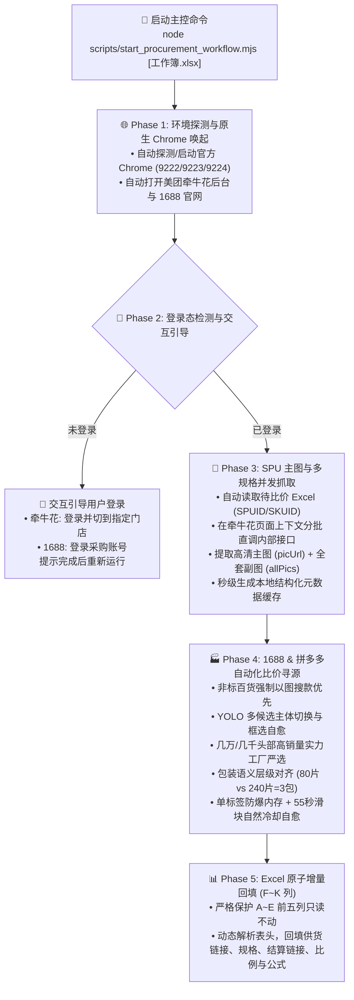

# 拼多多与 1688 采购寻源与自动化比价引擎 (pddauto)

[](VERSION)
[](#一全流程闭环架构)

本仓库专用于即时零售闪电仓与多渠道货盘的**跨平台（美团牵牛花全店 SPU 主图抓取 + 1688 源头工厂 + 拼多多单件包邮）全流程自动化采购寻源、同 SPU 多规格聚合比价、相似品多模态核验及标准结算链接回填 Skill**。

---

## 一、 全流程闭环架构



---

## 二、 核心目录结构

```text
pddauto/
├── SKILL.md                                           # 🧭 Skill 顶层入口与全流程操作手册
├── README.md                                          # 📖 仓库导览与架构说明
├── VERSION                                            # 版本号 (2.1.0)
├── quick_validate.py                                  # 语法与单元测试一键自检脚本
├── agents/
│   └── openai.yaml                                    # Agent 界面展示与默认提示词配置
├── references/
│   ├── platforms/
│   │   ├── pdd.md                                     # 拼多多采购端平台入口
│   │   ├── pdd-sourcing-playbook.md                   # 拼多多 CDP / ADB / ESP32 实战规程与代码配方
│   │   └── ali1688-sourcing-playbook.md               # 1688 单标签防风控与 55s 滑块自愈手册
│   └── tasks/
│       ├── sourcing-and-similar-product-matching.md   # 寻源 SOP、相似品四级打分与六列合同
│       ├── unit-alignment-spec.md                     # 基础销售单位与多层级包装语义对齐规范
│       └── visual-bounding-box-sop.md                 # 以图搜款多主体修正与 YOLO 框选 SOP
└── scripts/
    ├── start_procurement_workflow.mjs                 # 🚀 全流程一键端到端主控脚本
    ├── qnh_spu_extractor.mjs                          # 📸 牵牛花全店 SPU 主图与多规格详情自动并发抓取器
    ├── unit_alignment.mjs                             # ⚖️ 包装语义解析与单位对齐核心算法
    ├── test_ratio.mjs                                 # ✅ 13 大典型实战用例自动化回归测试集
    ├── ali1688_sourcing_worker.mjs                    # 🏭 1688 高销以图搜款与单标签常驻检索主引擎
    ├── pdd_phone_worker_v3.mjs                        # 📱 拼多多移动端单件包邮校验引擎
    ├── pdd_sourcing_engine.py                         # 🛠️ 拼多多三级极速寻源与结算链接合成引擎
    ├── flush_excel.py                                 # 📊 Excel 原子增量写入工具 (动态 6 列映射)
    ├── test_pdd_sourcing_engine.py                    # ✅ 引擎确定性单元测试
    └── vision_ocr.swift                               # 🔍 macOS Apple Vision 原生极速 OCR 源码
```

---

## 三、 同事协同操作指引（一键全自动工作流）

```bash
# 1. 运行一键端到端工作流（自动启动 Chrome、打开牵牛花/1688、抓取主图、开始比价并写入表格）
node scripts/start_procurement_workflow.mjs /path/to/your_store_spus.xlsx

# 2. 如果提示未登录：
#    在自动弹出的 Chrome 中扫码登录牵牛花（并切换到要比价的门店）和 1688，再次运行上述命令即可！

# 3. 单独测试包装换算比率回归测试 (13 个核心测试用例)
node scripts/test_ratio.mjs

# 4. 运行全量 Python/Node 自检
python3 quick_validate.py
```
