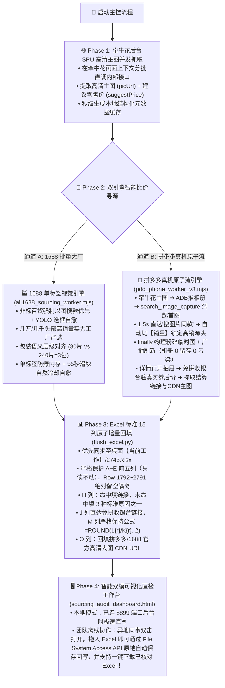

# 拼多多与 1688 供应链自动化寻源与比价治理 Skill (pddauto v2.5.0)

本 Skill 专用于即时零售闪电仓与多渠道货盘的**跨平台（美团牵牛花全店 SPU 主图抓取 + 1688 源头工厂 + 拼多多真机原生 App 相册单件原子流以图搜同款与免拼收银台极速验价）全流程自动化采购寻源、同 SPU 多规格聚合比价、相似品多模态核验、标准 15 列工作簿原子回填（C 列分配人、D 列商品名称只读保护，含 H 列 3 种标准未命中原因精炼归纳与 N 列未匹配协同、O 列供货商主图 CDN 链接）、桌面【当前工作】目录自适应同步、以及无需服务器的纯前端双向离线直检工作台**。

---

## 一、 全流程端到端闭环架构（从开浏览器/手机到抓图比价落盘与可视化直检）



---

## 二、 工作簿标准 15 列布局合同与分工范围（严格遵循）

### 1. 任务分工与处理范围
- **总商品规模**：2,790 个 SKU（行号 2 ~ 2,791）。
- **协同分工约定**：**最后 1,000 个 SKU（行号 1,792 ~ 2,791）已分配给协同人员跟进**，本自动化任务严格截止在 **第 1,791 行**（处理前 1,790 个 SKU），严禁覆盖或改动 1,792 行之后的任何数据（供货列必须 100% 保持完全留空）。
- **存储路径**：优先同步至桌面【当前工作】目录：`/Users/cenbusi/Desktop/当前工作/2743.xlsx`。

### 2. 标准 15 列架构清单

| 列号 | 列名 | 职责与属性 | 写入规则 / 计算公式 / 异常标识 |
| :---: | :---: | :---: | :--- |
| **A** | `SPUID` | 门店商品 SPU 唯一编码 | 🔒 **只读保护**，严禁篡改 |
| **B** | `SKUID` | 门店商品 SKU 唯一编码 | 🔒 **只读保护**，严禁篡改 |
| **C** | `分配人` | 内部运营分配标识 | 🔒 **只读保护**，严禁改动 |
| **D** | `商品名称` | 门店商品原始全称 | 🔒 **只读保护**，严禁篡改 |
| **E** | `规格名称` | 门店原始销售规格 | 🔒 **只读保护**，严禁篡改 |
| **F** | `当前原价` | 门店建议零售价 | 提取自牵牛花 `suggestPrice` 真实零售指导价 |
| **G** | `主图链接` | 门店官方高清主图 URL | 提取自牵牛花内部接口 `picUrl` 高清大图 |
| **H** | `供货商品链接` | 货源详情页 / **未命中标准原因** | **命中时**：真实大厂详情页 URL<br>**未命中时**：严格精炼为 3 种标准状态之一（详见第三节）<br>**排队中**：保持留空 |
| **I** | `供货规格` | 供货商 SKU 规格描述 | 格式化后的供货属性（未匹配时留空） |
| **J** | `结算链接` | 真实直达免拼收银台链接 | 拼多多直达免拼收银台链接 / 1688 直购详情页（未匹配时留空） |
| **K** | `下单比例` | 包装换算倍率 $N$ | 语义对齐后的倍率（未匹配时留空） |
| **L** | `采购价` | 供货商起订总价 | 浮点数，保留两位小数（未匹配时留空） |
| **M** | `单位采购价` | 折算到手单价公式 | **严格使用 Excel 公式**：`=ROUND(L{row}/K{row}, 2)`（未匹配时留空） |
| **N** | `是否匹配` | 审核与完成状态列 | **匹配成功**：`匹配`<br>**未找到合规货源**：`未匹配`<br>**人工核验标记错误**：`不匹配`<br>**排队待检索**：保持留空 |
| **O** | `供货商主图` | 供货商官方高清主图 URL | 拼多多官方 CDN 大图 (`thumb_url`) / 1688 主图 URL，供看板大图比对渲染 |

---

## 三、 未找到货源的 3 大标准精简原因规范（H 列与 N 列协同）

严禁杂乱无章的自定义备注，**所有未命中情况严格归纳合并为 3 种标准状态**，格式统一为 `[{平台}] {原因}`：

| 状态编号 | 归纳合并的标准原因 | 覆盖的底层实际情况（合并项） | H 列填入效果示例 | 对应 N 列 |
| :---: | :--- | :--- | :--- | :---: |
| **状态 1** | **搜无同款高销货源** | 1. 牵牛花官方主图识图无结果<br>2. 提纯品牌品名关键词搜索无同款<br>3. 虽有候选但累计销量 $<50$ 件（剔除无销、高仿李鬼或幽灵店）<br>4. 门店自有品牌或特殊包装全网无源头工厂 | `[1688] 搜无同款高销货源`<br>或 `[拼多多] 搜无同款在售货源` | `未匹配` |
| **状态 2** | **规格装量不匹配** | 1. 找到同品牌/同类商品，但供货商在售规格与门店在售规格冲突（例如门店卖 500ml 单瓶，供货商只有 1L 或 200ml）<br>2. 颜色/型号/口味不一致，且不可替代<br>3. 单件拆零包装缺失（如仅有工业不可拆大包装，无法对齐基础销售单元） | `[1688] 规格装量不匹配`<br>或 `[拼多多] 规格装量不匹配` | `未匹配` |
| **状态 3** | **成本超标(毛利<50%)** | 1. 找到同款且规格吻合，但裸价折算后单件成本高于门店原价 50%（毛利不达标）<br>2. 起订量（MOQ）过大或平摊运费后，单件到手成本高于原价 50% 甚至价格倒挂 | `[1688] 成本超标(毛利<50%)`<br>或 `[拼多多] 成本超标(毛利<50%)` | `未匹配` |

---

## 四、 拼多多真机原生 App 相册单件原子流以图搜图与直达链接规范

### 1. 为什么坚决使用真机相册识图原子流？
- **告别 PC 网页端频繁登录与反爬验证**：拼多多移动端 H5 具有极高风控对抗（频繁弹滑块、掉登录态、拦截搜索）。而连接 Android 实体真机（USB/ADB），驱动拼多多官方原生 App，天然具有硬件级真实环境，买家号会话稳定，连续执行数百个 SPU 零风控拦截。
- **视觉识图准确率碾压纯关键词**：门店商品常含大量促销长词（如“【防震防尘防水】便携小巧车载优盘大容量/个”），关键词切词极易搜偏搜杂。而将牵牛花门店高清主图注入拼多多原生识图引擎后，秒级直达“搜图片同款”，精准锁定同款同规格官方正品！

### 2. 单件原子流相册识图（Atomic Image Search）标准作业 SOP
```
[牵牛花门店主图 URL]
      │ (curl 极速写入本地 /tmp/pdd_task_tmp_{ts}.jpg)
      ▼
[ADB 推送至真机 /sdcard/DCIM/Camera/] ➔ [am broadcast 发送媒体扫描广播]
      │
      ▼
[唤起 pinduoduo://com.xunmeng.pinduoduo/search_image_capture.html]
      │ (自动消除“对准商品”暗光提示，模拟点击相册条首张图 x:100, y:2300)
      ▼
[拼多多“搜图片同款” (sjs_search_img) 结果页]
      │
      ├─► [自动点击“销量”Tab] ➔ 精准锁定几万至十万件高销官方源头工厂
      │
      └─► [finally 强制物理销毁] ➔ rm -f 手机临时图并二次广播媒体刷新，相册 0 留存 0 污染！
```

### 3. 直达结算链接与主图 CDN 抓取（纠正历史错误认知）
- **结算链接获取机制（J列）**：进入商品详情页后，点击购买唤起 SKU 抽屉，匹配合规规格后加入收藏并触发免拼收银台；通过 Android `dumpsys activity com.xunmeng.pinduoduo` 内存转储，精准提取真实 `goods_id` 与 `sku_id`，直达免拼收银台链接：
  `https://mobile.yangkeduo.com/order_checkout.html?goods_id={goods_id}&sku_id={sku_id}&goods_number=1`
- **官方高清主图获取机制（O列）**：从内存转储的 `thumb_url` 参数中直接获取拼多多官方 CDN 原图 URL，同步写入工作簿第 15 列（O列【供货商主图】）及可视化看板中。
- **免拼收银台真实验价**：进入 `order_checkout.html` 自动核验店铺券、百亿补贴官方狂补后的**真实到手支付价**，剔除页面虚标低价。
- **收藏夹自动清理**：核验完毕后立即调用自动化清空收藏夹，保持买家账号清洁。

---

## 五、 智能双模可视化直检工作台（支持异地协同零安装）

为了支持跨地域、在家办公（无共享局域网）的团队高效协同审核，直检看板具备**智能双模自适应架构**：

### 1. 运行模式自动切换
- **模式 A（本地开发者直连）**：
  - 若检测到本机运行有 `audit_server.mjs`（`127.0.0.1:8899`），页面顶部显示蓝色 `⚡ 极速直写模式`，卡片点击 0.2 秒内通过后台 Python/Node 脚本极速回写 Excel。
- **模式 B（异地办公/离线协作模式）**：
  - 异地同事无需安装任何环境，双击打开 `sourcing_audit_dashboard.html`；
  - 页面顶部展示拖拽引导框：**【📂 关联本地 2743.xlsx】**；
  - 同事只需将收到的 `2743.xlsx` 拖入横幅（或点击选择一次），Chrome/Edge 自动通过现代浏览器原生的 **File System Access API** 激活文件写盘句柄；
  - 同事在网页上看大图比对，点击【❌ 匹配错误】或【✅ 恢复匹配】，**网页底层的 SheetJS 引擎在后台直接、原地修改他们电脑硬盘上的原 `2743.xlsx` 文件的 N 列**！
  - 审核完毕直接把电脑上的 Excel 回传，无需任何手动导出操作；
  - 对不支持原地写盘的浏览器，常驻 **【📥 下载已核对 Excel】** 按钮提供通用保底下载。

---

## 六、 采购寻源与移动端工程实践红线（彻底澄清历史误区）

1. **纠正历史误区 1：手机 App 无法获取结算链接？**
   - **完全错误**。通过 Android `dumpsys activity com.xunmeng.pinduoduo` 内存 Bundle 转储，100% 能提取到选中规格的 `goods_id` 与 `sku_id`，直达免拼收银台链接 `order_checkout.html?goods_id=...&sku_id=...&goods_number=1`。
2. **纠正历史误区 2：手机端拿不到商品主图 CDN URL？**
   - **完全错误**。内存转储中的 `thumb_url` 即为官方高清大图 CDN 链接，已标准化录入 Excel 第 15 列（O列）。
3. **纠正历史误区 3：手机搜索容易受非标长标题误导？**
   - 纯关键词搜索确实受标题修饰词干扰，因此**必须强制优先使用相册单件原子流以图搜同款**！识图能秒级过滤所有标题修饰语，配合“销量”Tab 直接命中几万件源头款。
4. **纠正历史误区 4：以图搜图会导致手机相册爆满？**
   - 单件原子流采用严格的 `finally { rm -f && am broadcast ... }` 机制，搜完立即物理删除并刷新媒体库，相册实现 **0 留存、0 污染**。
5. **保底毛利红线（半价门槛）**：
   - 到手单价必须 $\le$ 门店建议零售价的 50%（即毛利 $\ge 50\%$），高于此红线的货源即便有同款也一律坚决不采纳，严格保护店铺利润！
6. **严格保护 A~E 前五列及 Row 1792~2791**：
   - A~E 列只读保护；M 列严格保持公式 `=ROUND(L{row}/K{row}, 2)`；Row 1792~2791 供货列必须 100% 保持完全留空！

---

## 七、 核心脚本清单

1. **主控流程与真机 Worker**：
   - 拼多多真机原子流识图与比价 Worker：`scripts/pdd_phone_worker_v3.mjs`
   - 1688 单标签高销视觉 Worker：`scripts/ali1688_sourcing_worker.mjs`
   - 牵牛花全店主图高速提取引擎：`scripts/qnh_spu_extractor.mjs`
   - 标准 15 列增量写入器：`scripts/flush_excel.py`
   - 智能双模直检看板生成器：`scripts/export_visual_audit_html.py`
   - 实时交互服务：`scripts/audit_server.mjs`
