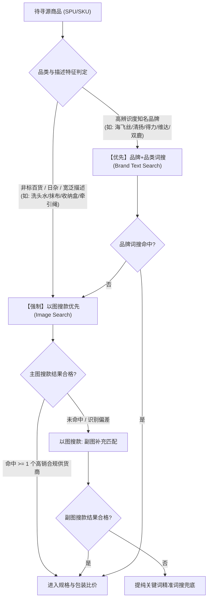

# 拼多多与 1688 供应链自动化寻源与比价治理 Skill (pddauto v2.0.0)

本 Skill 专用于即时零售闪电仓与多渠道货盘的**跨平台（1688 源头工厂 + 拼多多单件包邮）采购寻源、同 SPU 多规格聚合比价、相似品多模态核验及标准结算链接回填**。

所有执行规程均来自高强度真实店铺采买、海量商品池寻源与多轮平台风控实战磨合。团队同事协同操作时，必须严格执行本 SOP 规定的业务红线、单位对齐算法与防风控铁律。

---

## 一、 按需加载顺序（Load Order）

执行跨平台寻源比价任务时，按以下顺序阅读规范与调用引擎：

1. **第 1 层（平台通道与架构总览）**：
   - 拼多多平台总览：[`references/platforms/pdd.md`](references/platforms/pdd.md)
   - 1688 单标签与防风控实战：[`references/platforms/ali1688-sourcing-playbook.md`](references/platforms/ali1688-sourcing-playbook.md)
2. **第 2 层（业务任务与数据合同）**：
   - 基础包装语义层级与成本对齐：[`references/tasks/unit-alignment-spec.md`](references/tasks/unit-alignment-spec.md)
   - 以图搜款多主体修正与 YOLO 框选：[`references/tasks/visual-bounding-box-sop.md`](references/tasks/visual-bounding-box-sop.md)
   - 相似品打分矩阵与六列交付规范：[`references/tasks/sourcing-and-similar-product-matching.md`](references/tasks/sourcing-and-similar-product-matching.md)
3. **第 3 层（底层实战配方与代码规程）**：
   - 拼多多 CDP / ADB / ESP32 三级通道：[`references/platforms/pdd-sourcing-playbook.md`](references/platforms/pdd-sourcing-playbook.md)
4. **核心执行脚本与回归单测**：
   - 包装语义对齐解析器：[`scripts/unit_alignment.mjs`](scripts/unit_alignment.mjs)
   - 算法回归测试集（13 用例）：[`scripts/test_ratio.mjs`](scripts/test_ratio.mjs)
   - 1688 单标签以图搜款引擎：[`scripts/ali1688_sourcing_worker.mjs`](scripts/ali1688_sourcing_worker.mjs)
   - 拼多多真机与结算校验引擎：[`scripts/pdd_phone_worker_v3.mjs`](scripts/pdd_phone_worker_v3.mjs)
   - 拼多多三级极速寻源引擎：[`scripts/pdd_sourcing_engine.py`](scripts/pdd_sourcing_engine.py)
   - 工作簿增量安全落盘工具：[`scripts/flush_excel.py`](scripts/flush_excel.py)

---

## 二、 采购寻源八大最高红线（严禁违背）

1. **保底毛利红线（半价门槛）**：
   - **含运费到手单价 $\le$ 门店零售价的 50%**（即 $\text{采购单价} \le \text{零售价} \times 0.50$）。
   - 保底毛利率 $\ge 50\%$，低于此毛利的货源直接剔除或降级候选。
2. **起订量与库存硬指标**：
   - **起订量（MOQ）**：$\text{MOQ} \le 25$（首单轻量化试错，禁止推荐动辄起订几百上千件的工业大单品）。
   - **现货可用库存**：$\text{库存} \ge 20$（防止虚假挂单或即将断货的链接）。
3. **供货商高销严选（杜绝低销幽灵店）**：
   - **强力优先高销量**：优先选取近 30 天或累计成交 **几万**（10,000+）或 **几千**（1,000+）件的源头实力工厂、金牌制造档口。
   - **坚决剔除低销幽灵店**：对于成交量仅有几十件（$< 50$ 件）或 0 件的链接，**一律直接剔除**（防虚假标价、防无货倒卖、防假冒伪劣）。
4. **到手成本必须全额平摊阶梯运费**：
   $$\text{Landed Cost (到手单价)} = \frac{\text{SKU裸价} \times \text{起订量} + \text{首重运费}}{\text{起订量} \times \text{包装换算比率 } N}$$
5. **同 SPU 多 SKU 预聚合（Step 0 必做）**：
   - 先按 `SPUID` 聚合表格行，同一 SPU 仅获取 1 次主图、检索 1 次详情页，从 `goods.skus` 一次性提取全量规格批量匹配。
6. **严禁算法伪造或推算 ID**：
   - 不存在的 `goods_id`/`sku_id` 会触发拼多多/1688 WAF 100% 拦截；所有 ID 必须从真实页面 `rawData` 或 ADB 内存真实提取。
7. **标准结算链接唯一规范**：
   - 拼多多结算链接格式：`https://mobile.yangkeduo.com/order_checkout.html?goods_id={goods_id}&sku_id={sku_id}&goods_number=1`，**严禁拼接失效 `group_id`**。
   - 1688 链接格式：`https://detail.1688.com/offer/{offerId}.html`。
8. **价格单位防除以 100 陷阱**：
   - 拼多多 `sku.group_price` 原生已是以**元**为单位的字符串（如 `"33.90"`），严禁除以 100。

---

## 三、 搜索路由分流策略：搜图优先 vs 品牌词搜

不同品类商品的特征差异极大，不能用一套搜索方式通打全店：



### 1. 非标百货 / 日用杂货 / 宽泛描述品（强令：以图搜款优先）
- **典型商品**：洗脸巾、抹布、宠物牵引绳、收纳箱、垃圾袋、塑料盆、五金挂钩、洗头洗发水等。
- **业务痛点**：此类商品在门店中的描述极其宽泛（如“洗头洗发水”）。若直接用文本搜索，超市里所有的洗发水都会被搜出来，无法命中款式与材质。图片具有唯一的形态特征，必须通过搜图定位。
- **执行规范**：
  1. 提取门店高清主图；
  2. 使用 1688 或拼多多相册搜图比对；
  3. 若主图被背景牛皮纸、门店贴纸或多物品干扰，自动拉取第 2、第 3 张副图重新搜图。

### 2. 知名品牌 / 强参数数码标品（优先：品牌精简词搜）
- **典型商品**：海飞丝、清扬、得力、维达、晨光、双鹿电池等。
- **提取规则**：严格去除“【超值装】”、“买一赠一”等促销词，提取：`[品牌] + [核心品类名词] + [规格/净含量]`。

---

## 四、 以图搜款多主体修正与 YOLO 框选自愈 SOP

1688 的以图搜款后台集成了视觉 YOLO 目标检测模型，经常在多主体画面中把主体识别错误。

### 典型案例：宠物胸背带式牵引绳
- **问题**：商品为“宠物胸背带式牵引绳 1套”，图片中央为金毛犬佩戴背带。1688 YOLO 算法默认在金毛犬头部和身体打框，导致搜出来的全是“纯种金毛幼犬”、“宠物狗活体”或“狗粮”，无牵引绳。
- **标准自愈操作流**：
  1. **多候选主体轮询切换**：
     - 页面加载后，检测 `.cropRegion--gagAdM3S` 候选识别主体节点数。
     - 若数量 $> 1$，依次点击第 2、第 3 个候选框，每次切换等待 2 秒让商品列表刷新。
  2. **自适应“框选主体”重绘**：
     - 若候选主体仍不准，触发“框选主体”（`.cutTxt--BegJKt5I`）工具。
     - 在 `#croper-canvas` 视口中，按目标商品的实际包围盒坐标（跳过周围人物/宠物，避开边缘 15% 干扰区）重绘选框，点击确定重新检索。

---

## 五、 基础销售单位与多层级包装语义对齐规范

必须建立严密的两级单位解析器，杜绝将多件装散片当成单包核算导致亏损！

### 典型痛点：家庭装 80 片 vs 240片/480片散片
- **门店商品**：“柔巾卷洗脸巾一次性纯棉洁面巾 家庭装80片”，规格“80片*1包”，零售价 ¥5.90。
- **供货商规格**：
  - 规格 A：“240片（3包装）”，整件价格 ¥12.00；
  - 规格 B：“480片（6包整箱）”，整件价格 ¥21.60。
- **正确对齐逻辑**：
  - 门店的销售最小单元是 **“1 包（含80片）”**。
  - 规格 A 的 240 片对应 $240 \div 80 = 3$ 包，单包成本为 $¥12.00 \div 3 = ¥4.00$。
  - 规格 B 的 480 片对应 $480 \div 80 = 6$ 包，单包成本为 $¥21.60 \div 6 = ¥3.60$。
  - **严禁直接除以 240 或 480 算出几分钱单片价格！**

### 包装换算比率 $N$ 计算法则
1. **耐用品硬保护（Durable Goods Protection）**：
   - 菜板、砧板、剪刀、壁纸刀、保温杯、平底锅、数据线、收纳盒等。
   - 严禁除以标题或规格中附赠的防尘袋、自粘袋、标签数量（换算比率坚决强制为 1）。
2. **显式单包装识别（Single Pack Override）**：
   - 规格中明确标注“单包”、“1包”、“1盒”、“120片/包”、“60抽单包”且无其他外包装乘数时，换算比率严格为 1。
3. **复合包装分层换算（Compound Pack Resolution）**：
   - 门店含内含件数 $P_{store}$（如 80片/包、200支/盒、2节/卡）：
     - 供货商标有外包装数 $O_{sup}$（如 3包、6盒、10提），则 $N = \max(1, \mathrm{round}(O_{sup} \div O_{store}))$；
     - 供货商仅标散装总数 $I_{sup}$（如 240片、480片、600支），则 $N = \max(1, \mathrm{round}(I_{sup} \div P_{store}))$。
4. **双/副对称品换算**：
   - 拖鞋、手套、袜子等成双出售的商品，若供货商规格写“1000只散装”，比率换算为 $1000 \div 2 = 500$ 双。

---

## 六、 单标签防风控与 55 秒滑块自然冷却自愈铁律

### 1. 严格单标签生命周期（防止标签页爆炸内存暴涨）
- **痛点**：1688 首页嵌入了许多全屏推广组件（例如“商机组货”、“跟风热卖”等），带有 `target="_blank"`。如果全局模糊匹配 innerText 为“搜索”的按钮，会误触营销 banner 瞬间弹出几十个标签页引发 Chrome 内存溢出。
- **防护规范**：
  1. 搜图弹窗搜索按钮必须使用精准作用域选择器：`.imageSearchPopover--f82RkwsD .actionPrimary--sz2L3jNq`，严禁向外扩散点击。
  2. 页面注入阻止外弹钩子：
     ```javascript
     window.open = (u) => { location.href = u; return window; };
     ```
  3. 执行每个 SPU 搜索前后，调用 CDP 检测并关闭所有临时衍生页，确保整个 Chrome 仅保留 1 个 1688 活动页。

### 2. 55秒滑块自然冷却自愈机制
- **核心规律**：阿里巴巴前端安全风控挑战（`nc_1_n1z` 或 Baxia 滑块）设计了约 50~60 秒的超时降级窗口。
- **自愈 SOP**：
  1. 检测到滑块弹窗后，立刻停止任何点击与拖拽动作（严禁用脚本暴力拖拽滑块）；
  2. 保持当前页面静置挂起 **55 秒**；
  3. 55 秒后直接执行 `location.reload()` 重新刷新页面；
  4. 刷新后该滑块拦截挑战自动解除消失，会话无缝恢复正常操作！
- **平滑频控保护**：两次图片上传之间必须平滑等待 $\ge 15$ 秒。

---

## 七、 交付 Schema 与常用命令

### 1. 运行包装语义算法回归测试
```bash
node scripts/test_ratio.mjs
```
*必须 13/13 PASS 全部通过方可投入生产。*

### 2. 启动 1688 自动化寻源引擎
```bash
node scripts/ali1688_sourcing_worker.mjs
```

### 3. 运行拼多多三级极速寻源引擎单测
```bash
python3 scripts/test_pdd_sourcing_engine.py
python3 quick_validate.py
```
