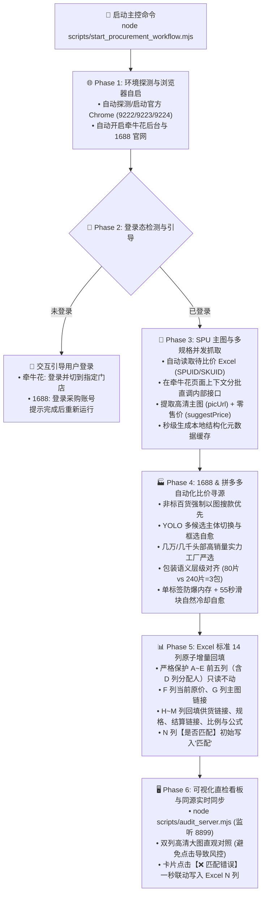

# 拼多多与 1688 供应链自动化寻源与比价治理 Skill (pddauto v2.2.0)

本 Skill 专用于即时零售闪电仓与多渠道货盘的**跨平台（美团牵牛花全店 SPU 主图抓取 + 1688 源头工厂 + 拼多多单件包邮）全流程自动化采购寻源、同 SPU 多规格聚合比价、相似品多模态核验、标准 14 列工作簿原子回填及可视化看板同源实时双向同步**。

---

## 一、 全流程端到端闭环架构（从开浏览器到抓图比价落盘与可视化直检）



---

## 二、 工作簿标准 14 列布局合同（严格遵循）

工作簿严格维护 14 列标准架构，绝对禁止篡改前五列：

| 列号 | 列名 | 职责与属性 | 写入规则 / 计算公式 |
| :---: | :---: | :---: | :--- |
| **A** | `SPUID` | 门店商品 SPU 唯一编码 | **只读保护**，严禁篡改 |
| **B** | `SKUID` | 门店商品 SKU 唯一编码 | **只读保护**，严禁篡改 |
| **C** | `门店名称` | 所属门店名称 | **只读保护**，严禁篡改 |
| **D** | `分配人` | 内部运营分配标识 | **只读保护**，严禁篡改 |
| **E** | `规格名称` | 门店原始销售规格 | **只读保护**，严禁篡改 |
| **F** | `当前原价` | 门店建议零售价 | 提取自牵牛花 `suggestPrice` 真实零售指导价 |
| **G** | `主图链接` | 门店官方高清主图 URL | 提取自牵牛花内部接口 `picUrl` 高清大图 |
| **H** | `供货商品链接` | 1688 或拼多多商品页 URL | 真实大厂源头货源详情页 |
| **I** | `供货规格` | 供货商 SKU 规格描述 | 格式化后的供货属性（去噪去 HTML 转义） |
| **J** | `结算链接` | 真实直达结算链接 | 拼多多免拼结算链接 / 1688 直购详情页 |
| **K** | `下单比例` | 包装换算倍率 $N$ | 语义对齐后的倍率（如 80片 vs 240片 则 $N=3$） |
| **L** | `采购价` | 供货商起订总价 | 浮点数，保留两位小数 |
| **M** | `单位采购价` | 折算到手单价公式 | **严格使用 Excel 公式**：`=ROUND(L{row}/K{row}, 2)` |
| **N** | `是否匹配` | 人机协同质检审核列 | 默认回填“匹配”；看板点击【匹配错误】后实时联动更新为“不匹配” |

---

## 三、 可视化比价看板与同源实时双向同步规程

为了彻底解决运营人员逐个点击采购链接导致**平台风控拦截、浏览器标签页爆满及核验效率低下**的问题，引入本地轻量级可视化看板与同源实时同步系统：

### 1. 架构与运行
- **交互同步服务**：`node scripts/audit_server.mjs`
  - 默认监听 `http://127.0.0.1:8899`，支持跨域 CORS。
  - 提供 `/api/toggle-match?row={row}&status={MATCH|MISMATCH}` API。
  - 接收到请求后，立即原子更新本地进度缓存，并在 **0.2 秒内** 增量改写 `2743.xlsx` 对应行的第 14 列（N 列【是否匹配】）。
- **看板生成器**：`python3 scripts/export_visual_audit_html.py`
  - 自动将进度与 QNH 零售数据融合，导出单文件看板 `Desktop/sourcing_audit_dashboard.html`。
  - 用户可直接在浏览器中访问 `http://127.0.0.1:8899` 或双击打开本地 HTML 文件。

### 2. 卡片双列对比与极速审核体验
- **左侧（门店在售）**：高清大图、商品名称、规格、**真实在售原价**。
- **右侧（匹配货源）**：供货商大图、供货规格、下单倍率、采购总价、**折算到手单价**。
- **底部状态栏**：
  - **毛利率徽章**：`((原价 - 单位采购价) / 原价) * 100`（$\ge 50\%$ 绿色高亮）。
  - **平台与销量**：1688 源头大厂高销量展示（如“7.7万+件”）。
  - **直达链接**：一键直达免拼/直购页。
  - **【❌ 匹配错误】按钮**：
    - 运营人员顺次快速下滑，发现不匹配项直接点击；
    - 页面瞬间标记为不匹配（红框半透明置灰），右下角弹出 Toast 确认；
    - **Excel 表格的 N 列（是否匹配）同步改写为“不匹配”**，无需人工二次登记！
    - 支持误触时点击恢复为“匹配”。

---

## 四、 自动化工作流执行规程（同事操作指南）

同事协作时，只需执行以下标准步骤即可实现全自动作业：

### 步骤 1：一键启动全流程主控脚本
```bash
# 启动工作流（支持传入自定义 Excel 工作簿路径，未传时默认读取桌面表格）
node scripts/start_procurement_workflow.mjs /path/to/your_store_spus.xlsx
```

### 步骤 2：环境自启与账号登录就绪
- 脚本会自动检测或在后台唤起系统原生 Google Chrome（带远程调试端口，零 WebDriver 标记，彻底避开风控）；
- 自动打开两个核心标签页：
  - **Tab 1（牵牛花）**：`https://qnh.meituan.com/home.html#/unifiedGoods/store/spu-list`
  - **Tab 2（1688）**：`https://www.1688.com/`
- **账号登录指引**：
  若检测到尚未登录，脚本会在终端及会话中给出明确提示：
  > “请在已打开的 Chrome 窗口中完成以下账号登录：
  > 1. **美团牵牛花后台**：完成登录并切换至本次要比价的门店（确保能打开商品列表）；
  > 2. **1688 采购账号**：完成登录（确保首页右上角显示用户名，方便以图搜款与查看供货商优惠）；
  > 完成登录后，重新执行命令即可自动开始作业！”

### 步骤 3：自动高速抓取 SPU 主图与多规格详情（无需人工下载图片）
- 登录就绪后，脚本自动读取 Excel 表格中的全部待比价行；
- 依附到牵牛花页面，直接在页面会话上下文调用内部轻量级接口（`/qnh-gw3/api/product/tenant/page-query`），以 100 件/批的高并发分批直提：
  - 提取每个 SPU 的高清主图 URL（`picUrl`）；
  - 提取全量副图数组（`allPics`，主图命中不准时自动切换副图）；
  - 提取规格名（`specName`）、零售价（`suggestPrice`/`basicPrice`）、UPC 条码；
- 数千个商品的主图与规格将在 **10~20 秒内全量抽取完毕** 并存入本地缓存，杜绝逐个商品手动保存图片的低效操作。

### 步骤 4：全自动高销以图搜款、包装对齐与 Excel 原子回填
- 自动拉起 1688 单标签引擎，逐个 SPU 进行视觉搜索；
- 自动执行 YOLO 多主体框选修正、几万高销工厂筛选、基础包装语义对齐（家庭装 80 片 vs 240片/480片）；
- 实时通过 `openpyxl` 将标准 14 列增量回填至原工作簿。

### 步骤 5：启动可视化看板进行极速质检
```bash
# 启动实时交互服务
node scripts/audit_server.mjs
# 浏览器打开 http://127.0.0.1:8899 进行图片直检与一键标记
```

---

## 五、 采购寻源八大最高红线（严禁违背）

1. **保底毛利红线（半价门槛）**：
   - **含运费到手单价 $\le$ 门店零售价的 50%**（即 $\text{采购单价} \le \text{零售价} \times 0.50$）。
   - 保底毛利率 $\ge 50\%$，低于此毛利的货源直接剔除或降级候选。
2. **起订量与库存硬指标**：
   - **起订量（MOQ）**：$\text{MOQ} \le 25$（首单轻量化试错，禁止推荐动辄起订几百上千件的工业大单品）。
   - **现货可用库存**：$\text{库存} \ge 20$（防止虚假挂单或即将断货的链接）。
3. **供货商高销严选（杜绝低销幽灵店）**：
   - **强力优先高销量**：优先选取近 30 天或累计成交 **几万**（10,000+）或 **几千**（1,000+）件的源头实力工厂、金牌制造档口。
   - **坚决剔除低销幽灵店**：对于成交量仅有几十件（$< 50$ 件）或 0 件的链接，**一律直接剔除**（防虚假标价、防无货倒卖、防假冒伪劣）。
4. **到手成本必须全额平摊阶梯运费**：
   $$\text{Landed Cost (到手单价)} = \frac{\text{SKU裸价} \times \text{起订量} + \text{首重运费}}{\text{起订量} \times \text{包装换算比率 } N}$$
5. **同 SPU 多 SKU 预聚合（Step 0 必做）**：
   - 先按 `SPUID` 聚合表格行，同一 SPU 仅获取 1 次主图、检索 1 次详情页，从 `goods.skus` 一次性提取全量规格批量匹配。
6. **严禁算法伪造或推算 ID**：
   - 不存在的 `goods_id`/`sku_id` 会触发拼多多/1688 WAF 100% 拦截；所有 ID 必须从真实页面 `rawData` 或 ADB 内存真实提取。
7. **标准结算链接唯一规范**：
   - 拼多多结算链接格式：`https://mobile.yangkeduo.com/order_checkout.html?goods_id={goods_id}&sku_id={sku_id}&goods_number=1`。
   - 1688 链接格式：`https://detail.1688.com/offer/{offerId}.html`。
8. **价格单位防除以 100 陷阱**：
   - 拼多多 `sku.group_price` 原生已是以**元**为单位的字符串（如 `"33.90"`），严禁除以 100。

---

## 六、 核心参考规范与脚本清单

1. **核心脚本库**：
   - 主控流程启动脚本：`scripts/start_procurement_workflow.mjs`
   - 牵牛花全店主图提取引擎：`scripts/qnh_spu_extractor.mjs`
   - 1688 高销单标签寻源 Worker：`scripts/ali1688_sourcing_worker.mjs`
   - 标准 14 列原子写入器：`scripts/flush_excel.py`
   - 可视化看板生成器：`scripts/export_visual_audit_html.py`
   - 实时交互与 Excel 同步服务：`scripts/audit_server.mjs`
2. **平台与底层通道规范**：
   - 1688 单标签防风控与 55s 滑块自愈：[`references/platforms/ali1688-sourcing-playbook.md`](references/platforms/ali1688-sourcing-playbook.md)
   - 拼多多三级极速通道：[`references/platforms/pdd.md`](references/platforms/pdd.md)、[`references/platforms/pdd-sourcing-playbook.md`](references/platforms/pdd-sourcing-playbook.md)
3. **任务与业务合同**：
   - 基础销售单位与多层级包装语义对齐：[`references/tasks/unit-alignment-spec.md`](references/tasks/unit-alignment-spec.md)
   - 以图搜款多主体修正与 YOLO 框选 SOP：[`references/tasks/visual-bounding-box-sop.md`](references/tasks/visual-bounding-box-sop.md)
   - 相似品打分矩阵与 14 列交付规范：[`references/tasks/sourcing-and-similar-product-matching.md`](references/tasks/sourcing-and-similar-product-matching.md)
