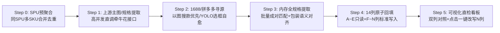

# 采购寻源与相似品多模态核验规范 (Sourcing & Similar Product Matching)

本规范是第 2 层任务合同，定义即时零售闪电仓**“上游采购寻源、同 SPU 多规格聚合、相似品图文多模态核验、保本毛利比价、标准 14 列原子回填与可视化看板同源实时同步”**的完整标准操作规程（SOP）。

---

## 一、 极速寻源总流程（Step 0 ➔ Step 5 闭环）

为将大批量货盘寻源速率拉到最高并保证 0 差错，必须严格按以下流水线执行：



1. **Step 0：同 SPU 多 SKU 预聚合（核心提速引擎）**
   - 先扫描整个货盘表，按 `SPUID` 将多行 SKU 聚合为 SPU 任务单元；
   - 记录每个 SPU 下的所有子 SKU 行号、规格名称、零售价与单件装量；
   - **铁律**：同一个 SPU 无论包含 2 个还是 10 个子 SKU，后续主图获取、拼多多/1688 搜索、商品详情页加载均**只执行 1 次**。
2. **Step 1：上游主图与基准事实提取**
   - 通过原生 Chrome CDP 在已登录牵牛花后台页面上下文直调轻量级接口（`/qnh-gw3/api/product/tenant/page-query`），以 100 件/批并发直提主图 URL（`picUrl`）与零售指导价（`suggestPrice`）。
3. **Step 2：1688 / 拼多多精准检索（以图搜款优先 / 关键词蒸馏）**
   - 优先以图搜款，配合 YOLO 框选自愈切换主体，锁定同款高销量/源头大厂商品。
4. **Step 3：详情页全量 SKU 一次性成对匹配与包装语义对齐**
   - 批量成对匹配装量、尺码、口味，精准计算下单比例（`K列`）与采购价（`L列`）。
5. **Step 4：标准 14 列（`A~N`）原子回填**
   - 严格保护前 5 列（A~E 列，包括 D 列分配人）只读不动；
   - 回填 F 列当前原价、G 列主图链接、H~M 列供货比价信息、N 列【是否匹配】（默认“匹配”）。
6. **Step 5：可视化直检看板同源实时同步**
   - 双列大图比对，避免逐个点开详情页导致风控；
   - 点击【❌ 匹配错误】按钮，通过本地服务 0.2 秒实时联动改写 `2743.xlsx` 第 14 列（N 列）为“不匹配”。

---

## 二、 核心经营铁律（四大死门）

1. **【铁律 1：物理装量与规格 100% 绝对一致（一票否决项）】**
   - 商品主图包装允许因批次或年份有微小迭代，但**单件物理装量/净含量/只数必须 100% 绝对吻合**！
   - 使用正则严格提取数字与物理单位：
     ```regex
     (?P<num>\d+(?:\.\d+)?)\s*(?P<unit>g|kg|ml|L|只|片|枚|颗|听|罐|袋|盒|支|双|条|包|瓶)
     ```
   - **零容忍错配**：
     - 严禁将 `250g` 错配给 `400g` 洗衣粉；
     - 严禁将 `1ml` 试用装/体验装错配给 `10ml` 正装外用喷剂；
     - 当供货规格为多件组合装（如家庭装 80 片 vs 240片/480片），而门店销售规格为单件时，必须在 K 列准确填入下单比例（如 `3` 或 `6`），使折算后的单位采购价精确对应门店单件销售规格！

2. **【铁律 2：单位采购价折算与保本毛利红线】**
   - 针对常见的**“多盒/多件批发组合装”**，必须通过 `K列（下单比例）` 自动折算单件成本：
     $$\text{单位采购价 (M列)} = \text{ROUND}\left(\frac{\text{采购价 (L列)}}{\text{下单比例 (K列)}}, 2\right)$$
   - 优先选择单件到手成本 $\le$ 原零售售价 50%（综合毛利率 $\ge 50\%$）的高销源头货源。

3. **【铁律 3：供货商高销严选（杜绝低销幽灵店）】**
   - **强力优先高销量**：优先选取近 30 天或累计成交 **几万**（10,000+）或 **几千**（1,000+）件的源头实力工厂、金牌制造档口。
   - **坚决剔除低销幽灵店**：对于成交量仅有几十件（$< 50$ 件）或 0 件的链接，**一律直接剔除**（防虚假标价、防无货倒卖、防假冒伪劣）。

4. **【铁律 4：搜索排序与广告横幅避坑】**
   - 避开高溢价竞价新品，在搜索结果页提取或点击商品卡片时，强制过滤品牌横幅推广广告，防止误入营销活动装修页。

---

## 三、 表格回填与交付标准 Schema（标准 14 列一体化闭环）

工作簿严格维护 14 列标准架构，绝对禁止篡改前五列：

| 列号 | 列名 | 填充规范与公式 | 示例数据 | 业务意义 |
| :---: | :--- | :--- | :--- | :--- |
| **A** | `SPUID` | 门店商品 SPU 唯一编码 | `1734491287413084195` | **只读保护**，严禁篡改 |
| **B** | `SKUID` | 门店商品 SKU 唯一编码 | `1734491287413637161` | **只读保护**，严禁篡改 |
| **C** | `门店名称` | 门店名称 | `龙猫购超市（余姚新城市店）` | **只读保护**，严禁篡改 |
| **D** | `分配人` | 内部运营分配标识 | `老宝大 正宗松花皮蛋` | **只读保护**，严禁改动 |
| **E** | `规格名称` | 门店销售规格 | `1个` | **只读保护**，严禁篡改 |
| **F** | `当前原价` | 门店建议零售价 | `2.50` | 门店官方指导在售价格 |
| **G** | `主图链接` | 牵牛花官方高清主图 URL | `http://p1.meituan.net/sgfn/...jpg` | 官方高清主图对照依据 |
| **H** | `供货商品链接` | 1688 或拼多多详情页 URL | `https://detail.1688.com/offer/...` | 大厂源头货源详情页 |
| **I** | `供货规格` | 供货商子规格文本 | `10枚【整箱】无铅` | 锁定款式/尺码/件数 |
| **J** | `结算链接` | 真实直达免拼/直购结算链接 | `https://mobile.yangkeduo.com/...` | 越过规格弹窗直达收银台 |
| **K** | `下单比例` | 包装换算倍率 $N$ | `10`（如卖1个，供货选10个装填10） | 采购拆零倍数与入库换算率 |
| **L** | `采购价` | 供货商起订总价 | `6.94` | 真实采购付款总价 |
| **M** | `单位采购价` | 动态公式 `=ROUND(L{row}/K{row}, 2)` | `=ROUND(L2/K2, 2)`（折合 `0.69` 元） | 折算到门店销售规格单件成本 |
| **N** | `是否匹配` | 质检审核列 | `匹配` / `不匹配` | 人机协同审核，看板点击一键联动更新 |

---

## 四、 结算链接抗风控与防伪造三大铁律

1. **绝对禁止伪造或推算 ID**：
   - 所有 `goods_id` 与 `sku_id` 必须来自真实详情页 `rawData` 提取，严禁推算。
2. **结算链接参数极简原则（严禁携带 `group_id`）**：
   - 必须且仅使用：`goods_id` + `sku_id` + `goods_number=1`。
3. **价格单位防除以 100 陷阱**：
   - 前端数据中价格本身就是以“元”为单位的字符串，直接转浮点数即可，严禁除以 100。
