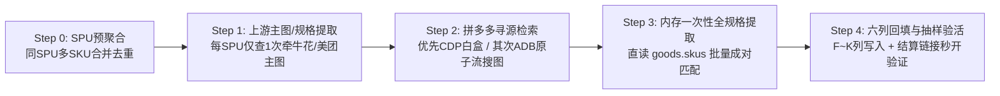

# 采购寻源与相似品多模态核验规范 (Sourcing & Similar Product Matching)

本规范是第 2 层任务合同，定义即时零售闪电仓**“上游采购寻源、同 SPU 多规格聚合、相似品图文多模态核验、保本毛利比价与标准六列回填”**的完整标准操作规程（SOP）。

---

## 一、 极速寻源总流程（Step 0 ➔ Step 4 黄金闭环）

为将大批量货盘寻源速率拉到最高并保证 0 差错，必须严格按以下 5 步流水线执行：



1. **Step 0：同 SPU 多 SKU 预聚合（核心提速引擎）**
   - 先扫描整个货盘表，按 `SPUID`（若无 SPUID 则按清洗后的主品名）将多行 SKU 聚合为 SPU 任务单元；
   - 记录每个 SPU 下的所有子 SKU 行号、规格名称、零售价与单件装量；
   - **铁律**：同一个 SPU 无论包含 2 个还是 10 个子 SKU，后续主图获取、拼多多搜索、商品详情页加载均**只执行 1 次**。
2. **Step 1：上游主图与基准事实提取**
   - 若货盘表未直接附带主图 URL，而主浏览器已登录牵牛花/美团/翱象后台，通过 CDP 在已登录后台页面上下文调用原生接口（如牵牛花 `/qnh-gw3/api/product/store/spu/list` 或 `/qnh-gw3/api/product/tenant/detail`），按 SPU 批量拉取主图 URL。
3. **Step 2：拼多多精准检索（关键词蒸馏 / 单件原子流搜图）**
   - 优先使用 **Chrome CDP 白盒通道** 或 **ADB 单件原子流以图搜图** 定位同款高销量/低价商品，锁定真实 `goods_id`。
4. **Step 3：详情页 `window.rawData` 全量 SKU 一次性成对匹配**
   - 从 `window.rawData.store.initDataObj.goods.skus` 中一次性读取所有在售子规格（过滤 `is_onsale !== 0` 且 `quantity > 0`）；
   - 将该 SPU 下的所有门店 SKU 与拼多多 `skus` 进行装量、尺码、口味、颜色的批量成对匹配，并自动计算每个 SKU 的**下单比例（I列）**与**单位采购价（K列）**。
5. **Step 4：标准六列（`F~K`）落盘与结算链接真机/CDP 秒开验真**
   - 写入 Excel 后，抽样 1~3 条 `H列（结算链接）` 在已登录 Chrome CDP 中导航验活，确认无“排队中”且直达含“立即支付”的收银台。

---

## 二、 核心经营铁律（三大死门）

1. **【铁律 1：物理装量与规格 100% 绝对一致（一票否决项）】**
   - 商品主图包装允许因批次或年份有微小迭代，但**单件物理装量/净含量/只数必须 100% 绝对吻合**！
   - 使用正则严格提取数字与物理单位：
     ```regex
     (?P<num>\d+(?:\.\d+)?)\s*(?P<unit>g|kg|ml|L|只|片|枚|颗|听|罐|袋|盒|支|双|条|包|瓶)
     ```
   - **零容忍错配**：
     - 严禁将 `250g` 错配给 `400g` 洗衣粉；
     - 严禁将 `1ml` 试用装/体验装错配给 `10ml` 正装外用喷剂；
     - 当拼多多规格为多件组合装（如 `10枚装`、`480ml*9瓶`），而门店销售规格为单件（如 `1枚`、`480ml/瓶`）时，允许采纳整包/整箱批发规格，但**必须在 I 列准确填入下单比例（`10` 或 `9`）**，使折算后的单位采购价精确对应门店单件销售规格！

2. **【铁律 2：单位采购价折算与保本毛利红线】**
   - 针对拼多多常见的**“多盒/多件批发组合装”**，必须通过 `I列（下单比例）` 自动折算单件成本：
     $$\text{单位采购价 (K列)} = \text{ROUND}\left(\frac{\text{采购价 (J列)}}{\text{下单比例 (I列)}}, 2\right)$$
   - 优先选择单件到手成本 $\le$ 原零售售价 50%（综合毛利率 $\ge 50\%$）或全网同款最低批发价的合规货源。

3. **【铁律 3：搜索排序与广告横幅避坑】**
   - 避开高溢价竞价新品，优先点击【销量】或【价格】排序选择高销量跑量款或整箱批发装；
   - 在搜索结果页提取或点击商品卡片时，**强制过滤 `rect.top > 200` 且排除 `mall_page.html` 品牌店铺横幅链接**，防止误入店铺装修页。

---

## 三、 关键词智能蒸馏算法（从货盘标题提炼精准搜索词）

### 1. 噪声清洗字典
- **营销噪点词**：`【整箱】`、`【单罐】`、`【啤酒】`、`【特惠】`、`正品`、`官方`、`原装`、`包邮`、`现货`、`熟食卤味`、`休闲追剧零食`、`解馋小吃`；
- **国标法定属性噪点**：`天然橡胶胶乳`、`外用液体剂型`；
- **标点符号清洗**：将 `/`、`+`、`*`、`【`、`】`、`(`、`)` 替换为空格。

### 2. 三要素蒸馏公式与下拉联想词策略
$$\text{Search\_KW} = \text{核心品牌} + \text{核心品名/功效} + \text{基础物理规格}$$

| 原始货盘商品全称 | 提取出的精准搜索词 | 避坑理由 |
| :--- | :--- | :--- |
| `碧浪ARIEL 纯净清香洗衣免搓粉 400g/袋` | `碧浪 洗衣免搓粉 400g` | 剔除英文 `ARIEL` 与包装词 `/袋`，保留核心功效 `免搓` 与物理规格 `400g` |
| `杰士邦 超薄玻尿酸天然橡胶胶乳避孕套 2只/盒` | `杰士邦 玻尿酸 2只` | 剔除冗长国标词 `天然橡胶胶乳`，精准命中渠道 2 只批发款 |
| `第6感 外用延时喷剂 10ml/盒` | `第六感 延时喷剂 10ml` | 阿拉伯数字 `第6感` 兼容中文 `第六感`，带规格 `10ml` |
| `松花皮蛋 1个`（多规格 SPU 含 1个 / 4枚） | `松花皮蛋 枚` | 同 SPU 搜一次，进入详情页后从 `goods.skus` 同时匹配 1 枚与 4 枚规格 |

- **下拉联想词优先命中**：在移动端搜索框输入关键词后，优先点击符合目标物理规格的下拉联想建议词，可显著降低推广大包装干扰。

---

## 四、 多模态相似品四级判定模型（满分 100 分，≥ 85 分放行）

| 评估维度 | 权重 | 判定准则与一票否决 |
| :--- | :---: | :--- |
| **1. 物理装量/规格一致性** | **40%** | **★ 一票否决项 ★**：单件净含量/容量/尺码冲突直接 0 分淘汰；多件批发装必须准确换算下单比例 `I列` |
| **2. 视觉包装与主图特征** | **30%** | 构图、主体色调、感知哈希 (pHash 汉明距离 $\le 12$)、品牌英文 Logo（如 `JISSBON`、`SIXSEX`、`Ariel`）一致，杜绝高仿山寨李鬼 |
| **3. 材质/系列属性精细核验** | **20%** | 细分品类严格区分（如天然乳胶 vs 高价仿生皮 PI；免搓粉 vs 普通机洗粉；无糖 vs 含糖） |
| **4. 店铺信誉与销量权重** | **10%** | 优先已拼 1000+ / 1万+、旗舰店、专营店或高评分批发老店 |

---

## 五、 表格回填与交付标准 Schema（六列一体化闭环）

寻源成功后，在原货盘 Excel 的 **F~K 列** 完整回填以下 6 列标准字段（支持人工采购核对与 RPA 批量代下单）：

| 列序号 | 列名 | 填充规范与公式 | 示例数据 | 业务意义 |
| :---: | :--- | :--- | :--- | :--- |
| **F 列** | **拼多多商品链接** | `https://mobile.yangkeduo.com/goods.html?goods_id={goods_id}` | `https://mobile.yangkeduo.com/goods.html?goods_id=940322316708` | 人工核对主图、评价与店铺信誉 |
| **G 列** | **拼多多规格** | 真实子规格文本；**多级规格严格以中文分号 `；` 间隔** | `480ML*9瓶【囤货】；混合口味 【新老包装随机】` | 准确锁定款式/尺码/口味/件数 |
| **H 列** | **结算链接** | `https://mobile.yangkeduo.com/order_checkout.html?goods_id={goods_id}&sku_id={sku_id}&goods_number=1` | `https://mobile.yangkeduo.com/order_checkout.html?goods_id=940322316708&sku_id=1892532124926&goods_number=1` | 越过规格弹窗，秒开直达收银台 |
| **I 列** | **下单比例** | $\max(1, \text{round}(\text{PDD规格内含件数} \div \text{门店SKU件数}))$ | `9`（如门店卖 1 瓶，拼多多选 9 瓶装，填 `9`） | 采购拆零倍数与入库换算率 |
| **J 列** | **采购价** | `parseFloat(sku.group_price)`（单位：**元**，保留 2 位小数） | `44.00` | 拼多多该规格真实拼团采购总价 |
| **K 列** | **单位采购价** | 动态公式 `=ROUND(J{row}/I{row}, 2)` | `=ROUND(J2/I2, 2)`（折合 `4.89` 元/瓶） | 折算到门店最小销售单元的真实单件成本 |

---

## 六、 结算链接抗风控与防伪造三大铁律（实战踩坑沉淀）

1. **绝对禁止伪造或推算 ID（“当前访问人数较多，排队中”的唯一根因）**：
   - 拼多多 WAF 对不存在的 `goods_id` 或无效的 `sku_id` **绝不返回 404，而是 100% 强制重定向至排队拦截页（“当前访问人数较多，排队中”）**；
   - 严禁通过算法脑补、哈希或占位符拼装链接！所有 `goods_id` 与 `sku_id` 必须来自真实详情页 `window.rawData.store.initDataObj.goods.skus` 提取。
2. **结算链接参数极简原则（严禁携带 `group_id`）**：
   - 必须且仅使用：`goods_id` + `sku_id` + `goods_number=1`；
   - **绝对禁止附带 `group_id`**（过期或非法的团号会触发拼单失效拦截）。
3. **价格单位防除以 100 陷阱**：
   - `window.rawData.store.initDataObj.goods.skus[i].group_price` 在前端对象中**本身就是以“元”为单位的字符串（如 `"33.90"`、`"44.00"`）**，直接转浮点数即可，**绝对禁止除以 100**！
