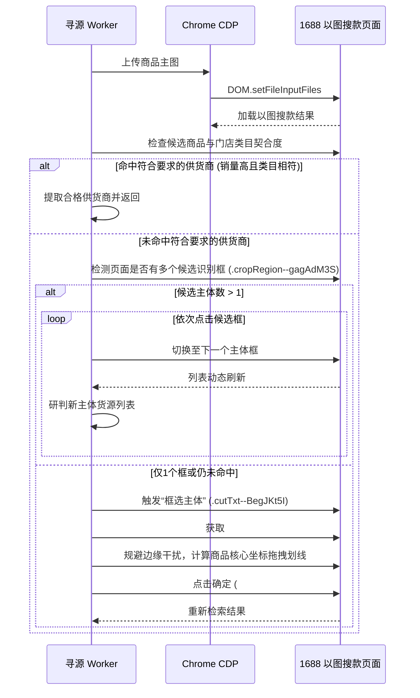

# 以图搜款多主体修正与 YOLO 框选自愈手册 (Visual Bounding Box SOP)

## 1. 痛点：1688 YOLO 目标检测在生活百货场景下的偏差

在美团牵牛花商品池中，许多商品带有场景图、真人佩戴图或宠物穿戴图。
- **典型误导场景**：
  - **商品**：宠物背带式牵引绳、狗项圈、胸背带。
  - **图片**：画面中央是一只大型金毛犬，狗狗身上系着细绳。
  - **1688 YOLO 默认行为**：系统自动在金毛犬的头部与身体上打框（识别为“犬/宠物狗”），完全忽略了狗身上的牵引绳。
  - **结果**：搜出来的全是“纯种金毛幼犬”、“宠物狗活体”、“狗粮罐头”，导致比价完全失败。
  - **其他场景**：
    - 婴儿棉签/卸妆巾：框选了包装盒旁边的模特人脸，搜出粉底液；
    - 手机壳/挂绳：框选了展示用的 iPhone 原机，搜出整机二手手机。

---

## 2. 标准自愈处理流程



---

## 3. 核心选择器与代码实现参考

```javascript
// 1. 识别并切换 1688 自动生成的多个 YOLO 候选区域
const regionCount = await pageSession.evalJs(`document.querySelectorAll('.cropRegion--gagAdM3S').length`);
if (regionCount > 1) {
  for (let rIdx = 0; rIdx < regionCount; rIdx++) {
    // 切换主体框并等待刷新
    await pageSession.evalJs(`document.querySelectorAll('.cropRegion--gagAdM3S')[${rIdx}]?.click()`);
    await sleep(2000);
    // 重新拉取研判
    const offers = await extractOffersFromImageSearchPage(pageSession);
    if (offers.length > 0) return offers;
  }
}

// 2. 自适应手动触发“框选主体”
const hasKuangxuan = await pageSession.evalJs(`Boolean(document.querySelector('.cutTxt--BegJKt5I'))`);
if (hasKuangxuan) {
  await pageSession.evalJs(`document.querySelector('.cutTxt--BegJKt5I')?.click()`);
  await sleep(800);
  
  // 获取画板尺寸
  const canvasRect = await pageSession.evalJs(`(() => {
    const canvas = document.querySelector('#croper-canvas');
    if (!canvas) return null;
    const r = canvas.getBoundingClientRect();
    return { left: Math.round(r.left), top: Math.round(r.top), width: Math.round(r.width), height: Math.round(r.height) };
  })()`);

  if (canvasRect) {
    // 避开背景，框取中心 70% 目标有效区域
    const sX = canvasRect.left + Math.round(canvasRect.width * 0.15);
    const sY = canvasRect.top + Math.round(canvasRect.height * 0.15);
    const eX = canvasRect.left + Math.round(canvasRect.width * 0.85);
    const eY = canvasRect.top + Math.round(canvasRect.height * 0.85);

    await pageSession.send("Input.dispatchMouseEvent", { type: "mousePressed", x: sX, y: sY, button: "left", clickCount: 1 });
    await pageSession.send("Input.dispatchMouseEvent", { type: "mouseMoved", x: eX, y: eY });
    await pageSession.send("Input.dispatchMouseEvent", { type: "mouseReleased", x: eX, y: eY, button: "left", clickCount: 1 });
    await sleep(600);
    await pageSession.evalJs(`document.querySelector('#croper-ok-btn')?.click()`);
    await sleep(2500);
  }
}
```
